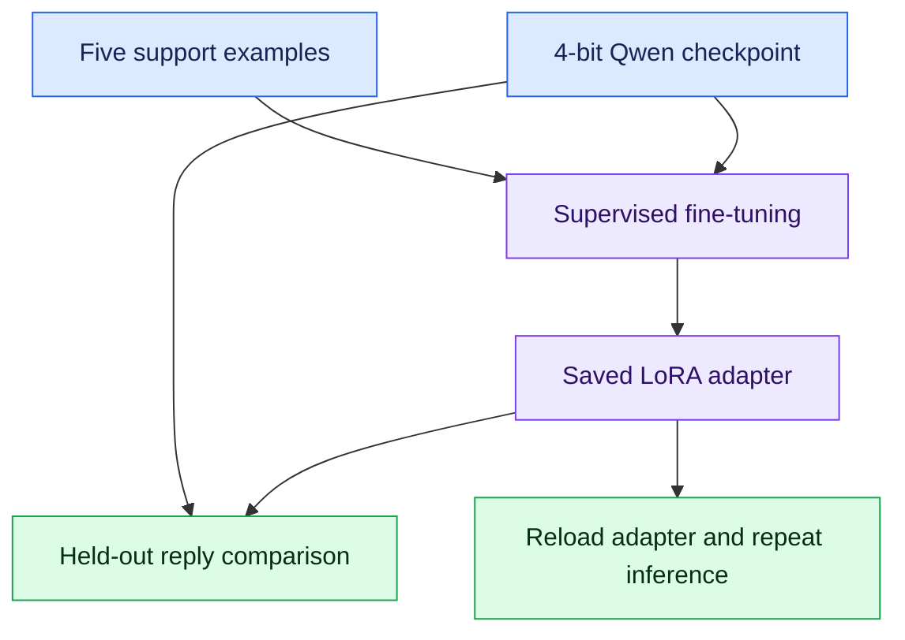

# 🧪 Customize an LLM for AI Agents with SFT and QLoRA

**Project 11 · 🟦 Learn AI · 🟩 Portfolio evidence · 🟪 BRI research direction**

Fine-tune Qwen2.5-1.5B-Instruct on synthetic support conversations in Google Colab. Compare the base and adapted replies, then reload the saved adapter and repeat an inference check.

[🚀 Open in Colab](https://colab.research.google.com/github/anne500/qlora-agent-finetuning/blob/main/project11_qlora.ipynb) · [🧩 Base tutorial vs Extensions](#contributions) · [📊 Verification](docs/verification.md)

## 🏗️ Workflow

## 🧩 Base tutorial vs Extensions

| Scope | Work | Status |
| --- | --- | --- |
| 🟦 Base tutorial | Supervised fine-tuning with a 4-bit base model and LoRA weights, followed by before/after inference and adapter reload. | Verified in Colab |
| 🟩 Adaptations | Tesla T4 runtime, five original synthetic examples, and the same base checkpoint, prompt, and decoding settings for each before/after pair. | Verified in Colab |
| 🟩 Evaluation extension | Four held-out prompts covering cancellation, missing delivery, refund status, and a delivery guarantee. | Results recorded |
| 🟪 Planned BRI extension | Evaluate structured CI evidence references and how the agent responds when logs are missing. | Planned |

## 🚀 Run the notebook

1. [Open the notebook in Colab](https://colab.research.google.com/github/anne500/qlora-agent-finetuning/blob/main/project11_qlora.ipynb) and select a GPU runtime. The verified run used a Tesla T4.
2. Run the cells in order to load the model, generate a baseline, train the adapter, and compare replies.
3. Run the reload cell and check the printed comparison. The optional download cell exports the adapter and tokenizer.

The repository notebook reconstructs the verified Colab workflow. Its install cell resolves the current package versions. The original environment and observed replies appear in the [verification log](docs/verification.md).

## 📊 Recorded results

The 30-step Colab run reported **1.2041 training loss**. The adapter removed an unsupported refund timeline and made the cancellation reply shorter. It also dropped the direct response about whether delivery could be guaranteed. The saved adapter reproduced the in-memory cancellation reply exactly after reload. [See all four comparisons](docs/verification.md).

## 🙏 Tutorial acknowledgment

Based on Darsh Shah’s freeCodeCamp article, [How to Customize an LLM for AI Agents using SFT and QLoRA](https://www.freecodecamp.org/news/how-to-customize-an-llm-for-ai-agents-using-sft-and-qlora/).
