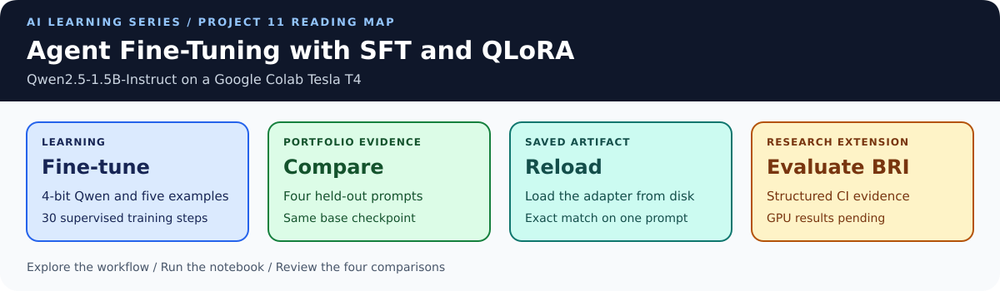
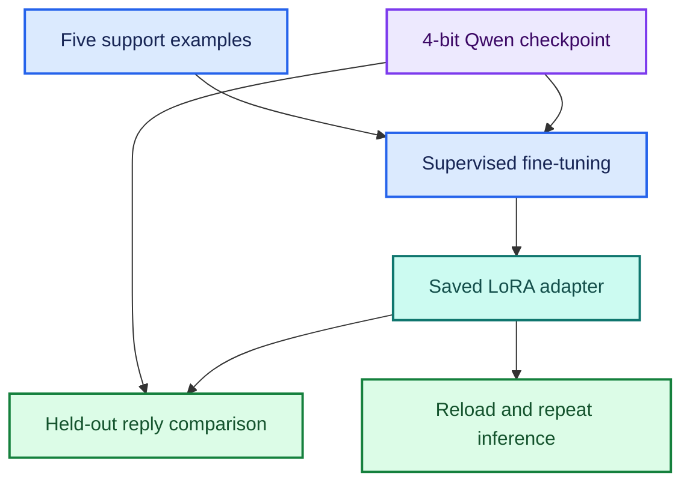
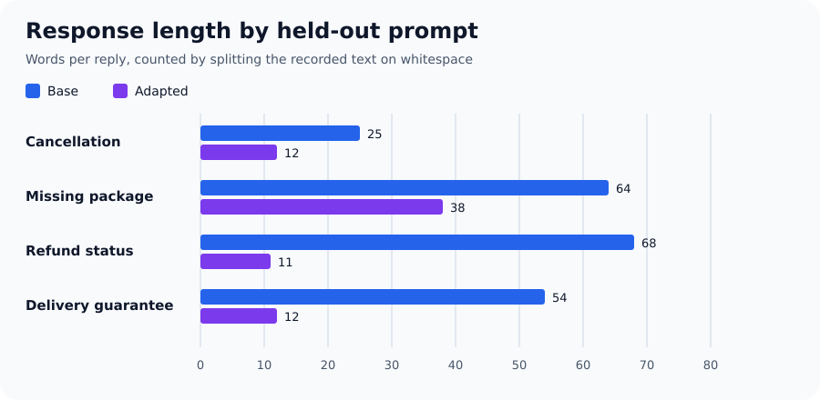

# 🧪 Customize an LLM for AI Agents with SFT and QLoRA

**Project 11 · 🟦 Learn AI · 🟩 Portfolio evidence · 🟪 PhD research**

Fine-tune Qwen2.5-1.5B-Instruct on synthetic support conversations in Google Colab, compare the replies, and verify an inference after reloading the adapter.

## 🧭 Explore the project

[🟦 Base tutorial](#base-tutorial) · [✨ Contributions](#contributions) · [🧭 Roadmap](#roadmap) · [🧩 Architecture](#workflow-architecture) · [🚀 Setup](#installation) · [🧪 Results & verification](#verification) · [🗂️ Evidence & guides](#project-files) · [🟪 Thesis connection](#thesis-connection) · [🎨 Visual standard](https://github.com/anne500/multi-agent-study-guide/blob/main/VISUAL_STYLE.md)

## 🟦 Base tutorial

Darsh Shah’s freeCodeCamp tutorial demonstrates supervised fine-tuning with a 4-bit base model, LoRA adapter weights, and a before-and-after response comparison. [Read the original tutorial](https://www.freecodecamp.org/news/how-to-customize-an-llm-for-ai-agents-using-sft-and-qlora/).

## ✨ Base tutorial vs Extensions

| Origin | Item | Scope or contribution | Verification |
| --- | --- | --- | --- |
| 🟦 Tutorial baseline | SFT and QLoRA | Train LoRA weights on a 4-bit base, compare replies, and reload the saved adapter. | Verified in Colab |
| 🟦 Adaptation | Colab and training examples | Use a Tesla T4 and five original synthetic support examples. | Verified in Colab |
| 🟦 Adaptation | Controlled comparison | Hold the base checkpoint, prompt, and generation settings fixed within each pair. | Verified in Colab |
| 🟩 Implemented extension | Held-out evaluation | Compare cancellation, missing delivery, refund status, and a delivery guarantee. | [Four recorded pairs](docs/verification.md) |
| 🟩 Implemented extension | CI evidence evaluation | Score JSON schema, evidence IDs, diagnosis, and missing-log behavior on four paired held-out incidents. | [T4 results verified](docs/bri-extension-verification.md) |

## 🧭 Project roadmap

| 🟦 Tutorial and setup | 🟩 Portfolio evidence | 🟪 Research verification |
| --- | --- | --- |
| ✅ Load 4-bit Qwen and train LoRA on Colab | ✅ Compare four held-out replies and verify adapter reload | ✅ Run the GPU comparison and verify the CI evidence scores. |

## 🧩 Workflow architecture

Training uses the 4-bit checkpoint and the support examples to produce a LoRA adapter. Evaluation compares replies from the same checkpoint with and without the trained adapter. The reload check reads the saved adapter from disk and repeats one prompt.

## 🚀 Run the notebook

1. [Open the notebook in Colab](https://colab.research.google.com/github/anne500/qlora-agent-finetuning/blob/main/project11_qlora.ipynb) and select a GPU runtime. The verified run used a Tesla T4.
2. Run the cells in order to load the model, generate a baseline, train the adapter, and compare replies.
3. Run the reload cell and check the printed comparison. The optional download cell exports the adapter and tokenizer.

The notebook reconstructs the verified Colab workflow. Its install cell resolves the current package versions. The original environment is recorded in the verification log.

## 🧪 Results and verification

The 30-step Colab run reported **1.2041 training loss**. The adapted replies were shorter on all four held-out prompts. The adapter removed an unsupported refund timeline but dropped the direct response about whether delivery could be guaranteed. The saved adapter reproduced the in-memory cancellation reply exactly after reload. [Read all four comparisons](docs/verification.md).

### ⚠️ Limitations

The chart measures reply length. Review the paired responses to assess whether each answer gives a useful next step and avoids unsupported claims. This run used five synthetic training examples and four held-out cases.

## 🗂️ Evidence and guides

| File | Contents |
| --- | --- |
| [Colab notebook](project11_qlora.ipynb) | Model loading, training, comparison, adapter reload, and download |
| [BRI extension verification](docs/bri-extension-verification.md) | Strict and Markdown-normalized scores, missing-log behavior, and diagnosis errors |
| [BRI extension notebook](project11_bri_extension.ipynb) | Synthetic fixtures, base and adapter comparisons, deterministic scoring, and JSON report |
| [Verification log](docs/verification.md) | Runtime details, recorded replies, and the reload transcript |

## 🟪 Thesis connection

The Build Release and Integration Engineering extension uses four synthetic held-out CI incidents. Each incident is evaluated with its diagnostic log and with only its run summary. The notebook compares base and adapted responses on JSON schema, exact evidence IDs, diagnosis, and appropriate abstention. [Run the BRI extension in Colab](https://colab.research.google.com/github/anne500/qlora-agent-finetuning/blob/main/project11_bri_extension.ipynb). On the Tesla T4 run, strict full passes rose from **0/8 to 6/8**. After removing Markdown fences, the comparison was **2/8 to 6/8**, with the gain coming from the four summary-only cases. [See the BRI verification results](docs/bri-extension-verification.md).

## 📚 Tutorial acknowledgment and attribution

Based on Darsh Shah’s freeCodeCamp article, [How to Customize an LLM for AI Agents using SFT and QLoRA](https://www.freecodecamp.org/news/how-to-customize-an-llm-for-ai-agents-using-sft-and-qlora/).
