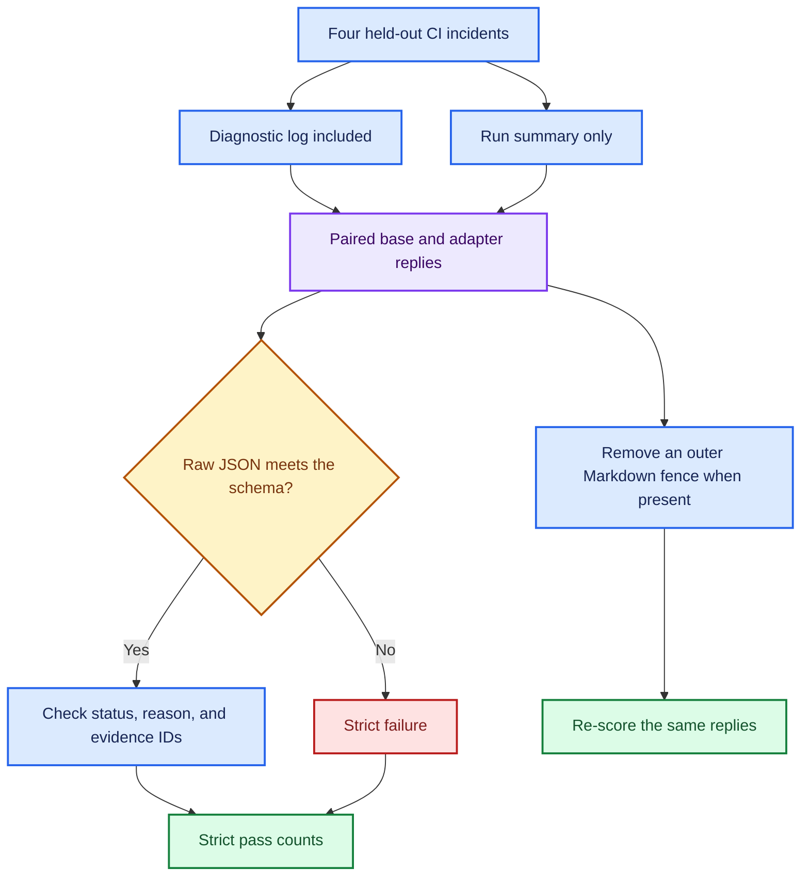
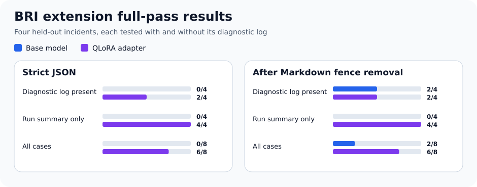

# 🧪 BRI extension verification

The reported Colab run trained a separate QLoRA adapter using eight synthetic training cases on a Tesla T4. The base checkpoint was `unsloth/Qwen2.5-1.5B-Instruct-bnb-4bit`, and the reported training loss was **0.0590**. Evaluation used four held-out incidents, each tested with its diagnostic log and with only its run summary. The notebook’s scorer reproduced all 16 reply scores in the Colab report.

## 🧩 How the evaluation works

## 📊 Scored results

### Strict JSON

The notebook requires one raw JSON object. A full pass also requires the exact expected status, reason, and evidence IDs.

| Held-out cases | Base full pass | Adapted full pass |
| --- | ---: | ---: |
| Diagnostic log present | 0/4 | 2/4 |
| Run summary only | 0/4 | 4/4 |
| All cases | 0/8 | 6/8 |

| Overall metric | Base | Adapted |
| --- | ---: | ---: |
| Valid schema | 0/8 | 7/8 |
| Exact evidence IDs | 0/8 | 7/8 |
| Correct status and reason | 0/8 | 6/8 |

## 🔍 Sensitivity to Markdown formatting

Every base reply wrapped its JSON in a Markdown fence. A post-run check removed one complete outer fence where present and reapplied the same scorer to both versions. This check used the recorded replies and preserved their contents.

| Held-out cases | Base full pass after fence removal | Adapted full pass after fence removal |
| --- | ---: | ---: |
| Diagnostic log present | 2/4 | 2/4 |
| Run summary only | 0/4 | 4/4 |
| All cases | 2/8 | 6/8 |

After fence removal, the base model passed the schema check on 8/8 cases. The full-pass improvement came from summary-only cases. On those four cases the base model guessed a build failure, while the adapter reported insufficient evidence with a null reason and an empty evidence list.

## ⚠️ Diagnosis errors

- **Beech with log.** The adapter picked the correct evidence ID but labeled an integration test timeout as `build_failure`. The expected reason was `test_failure`.
- **Maple with log.** The adapter cited the diagnostic log but used `release_check_failed`, a label outside the allowed schema. The expected reason was `policy_check_failed`.

Both versions passed two log-present cases after fence removal, with different passing cases. This single synthetic run supports an observation about missing-log behavior. More held-out incidents and repeated runs are needed to estimate generalization.
